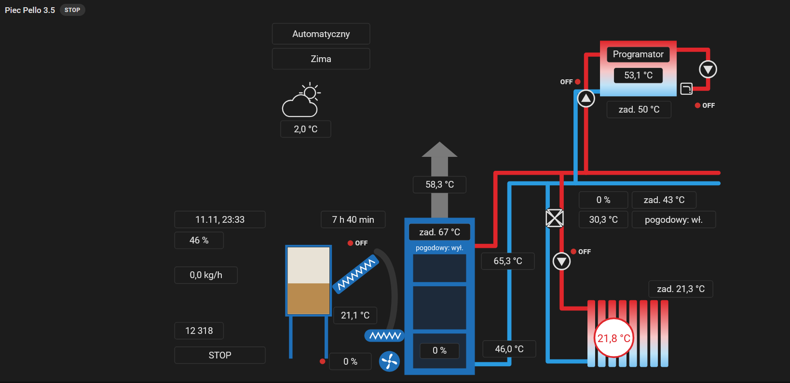

<p align="center">
  
</p>

<h1 align="center">eSterownik dla Home Assistant</h1>

<p align="center">
  <b>🔥 Pello · ⚫ eCoal — Twój kocioł w Home Assistant, lokalnie i bez chmury</b>
</p>

<p align="center">
  <a href="https://github.com/hacs/integration"></a>
  <a href="https://github.com/grzegorzfryc22/esterownik-ha/releases/latest"></a>
  
  
</p>

<p align="center">
  <a href="https://github.com/grzegorzfryc22/esterownik-ha/actions/workflows/validate.yml"></a>
  <a href="https://github.com/grzegorzfryc22/esterownik-ha/actions/workflows/tests.yml"></a>
  <a href="LICENSE"></a>
  
</p>

---

Integracja dla sterowników kotłów **[eSterownik.pl](https://esterownik.pl)** (ELEKTRO-SYSTEM):
**Pello** (kotły na pellet) i **eCoal** (kotły węglowe). Łączy się bezpośrednio ze stroną WWW
sterownika w Twojej sieci. Nie potrzebuje chmury, konta w aplikacji ani internetu.

## ✨ Co dostajesz

| | |
| :-- | :-- |
| 🌡️ **Temperatury** | kocioł, powrót, CWU, za zaworem 4D, w domu, na zewnątrz, spaliny, podajnik |
| 🎛️ **Sterowanie** | temperatura zadana kotła, CWU i obiegów CO, temperatury pokojowe, tryb Zima/Lato, tryb CWU, regulator pogodowy |
| 🛡️ **Ochrona powrotu** | wybór sposobu ochrony, tryb aktywacji i minimalna temperatura powrotu |
| 🪵 **Paliwo** | poziom w zasobniku, czas do opróżnienia, data kolejnego zasypu i akcja „rejestracja zasypu” |
| 🔥 **Palnik** | status pracy, płomień, moc, prędkość dmuchawy, liczniki rozpaleń |
| 🚨 **Alarmy** | każdy alarm sterownika jako osobna encja + przycisk „Potwierdzenie alarmów” |
| ⚙️ **Wyjścia i wejścia** | pompy, podajnik, dmuchawa, zawór, termostaty |
| 📊 **Wykresy** | statystyki długoterminowe dla pomiarów — gotowe do kart historii i wykresów |
| 🖼️ **Karta schematu** | wbudowana karta kotłowni z podglądem i sterowaniem (Pello) — [zobacz](#️-karta-schematu-kotłowni-pello) |

## 🖼️ Karta schematu kotłowni (Pello)

<p align="center">
  
</p>

Integracja ma wbudowaną kartę pulpitu w stylu dawnego podglądu sterownika: zasobnik
z poziomem pelletu, podajnik, kocioł z płomieniem, zawór 4D, obieg CO z grzejnikiem
i bojler CWU. Pompy i dmuchawa pokazują stan ON/OFF, a rury „płyną”, gdy pompy pracują.
**Nie trzeba niczego doinstalowywać** — karta jest dostępna od razu po instalacji integracji
(po aktualizacji odśwież przeglądarkę: Ctrl+Shift+R).

- 📈 **Kliknij temperaturę** — otworzy się okno encji z wykresem historii.
- 🎛️ **Kliknij nastawę** (zad. kotła, CWU, za zaworem, tryb CWU, Zima/Lato, regulator pogodowy,
  temperatury pokojowe) — otworzy się okno zmiany. Każdy zapis do pieca trzeba potwierdzić
  przyciskiem **„Zapisz w piecu”**.
- 🚨 Aktywne alarmy pokazują się nad schematem, z przyciskiem kasowania.
- 🔁 Opcjonalna **pompa cyrkulacji** z dowolnej encji (np. gniazdko ZigBee).
- 🌗 Motyw automatyczny (z Home Assistant), jasny lub ciemny.
- 📱 Mała karta statusu (`esterownik-pello-mini-card`) — po kliknięciu otwiera pełny schemat.

**Dodanie:** pulpit → **Edytuj** → **Dodaj kartę** → **Esterownik — Pello (schemat)** →
wybierz piec. Karta sama dobierze encje, także gdy zmieniłeś ich nazwy. W edytorze każdy
element schematu można podmienić na inną encję.

```yaml
type: custom:esterownik-pello-card
device_id: <wybierz piec w edytorze>
tylko_podglad: false      # true = sam podgląd, bez zapisu do pieca
motyw: auto               # auto | jasny | ciemny
# max_wysokosc: 600px     # ogranicza wysokość schematu
encje:                    # opcjonalnie: własne encje zamiast tych z pieca
  cyrkulacja: switch.pompa_cyrkulacji
  t_wewn: sensor.temperatura_salon
```

> Karta jest na razie dla **Pello**. Widok dla eCoal jest w planach.

## 🧠 Jak to działa

Sterownik ma wbudowany **słownik rejestrów** (`config/hardware.xml`) z polskimi nazwami,
jednostkami, zakresami i listami opcji. Integracja czyta ten słownik i **sama tworzy encje**.
Dzięki temu obsługuje różne modele i wersje oprogramowania bez ręcznego dopisywania rejestrów.

| Rejestr w słowniku | Encja w Home Assistant |
| :-- | :-- |
| 📈 Pomiar (temperatura, moc, %, kg/h…) | `sensor` ze statystykami |
| 🔢 Nastawa liczbowa (temperatura zadana, krzywa…) | `number` z zakresem i krokiem ze sterownika |
| 📋 Lista z zapisem (Zima/Lato, tryb CWU…) | `select` |
| 🔘 Wł./wył. z zapisem (regulator pogodowy…) | `switch` |
| 🚨 Alarm | `binary_sensor` typu „problem” |
| ⚡ Wyjście mocy, wejście | `binary_sensor` |
| 📅 Data (kolejny zasyp, ostatni zasyp) | `sensor` typu timestamp |
| ✅ Potwierdzenie alarmów | `button` |

Najważniejsze encje są włączone od razu. Pozostałe (parametry serwisowe, liczniki,
diagnostyka) są tworzone jako **wyłączone** — włączysz je w ustawieniach urządzenia.
Obiegi CO, bufor i moduły, których nie masz, są pomijane.

## 🧪 Obsługiwane sterowniki

| Sterownik | Oprogramowanie | Status |
| :-- | :-- | :-: |
| 🔥 **Pello v3.5** | 1.1.39.4 | ✅ sprawdzony na żywo |
| ⚫ **eCoal v4.0** | 1.1.36.14 | ✅ sprawdzony na zrzutach |
| ❔ inne eSterownik | — | 🟡 powinny działać, jeśli mają `config/hardware.xml` i `syncvalues.cgi` |

Masz inny model? [Zgłoś go](#-zgłoszenie-nowego-sterownika) — pomożesz innym.

## 🚀 Instalacja

[](https://my.home-assistant.io/redirect/hacs_repository/?owner=grzegorzfryc22&repository=esterownik-ha&category=integration)

1. **HACS** → wyszukaj **eSterownik** → **Pobierz**.
2. Zrestartuj Home Assistant.
3. Dodaj integrację:

   [](https://my.home-assistant.io/redirect/config_flow_start/?domain=esterownik)

   albo **Ustawienia → Urządzenia oraz usługi → Dodaj integrację → eSterownik**.
4. Podaj adres IP sterownika oraz login i hasło do jego strony WWW (zwykle użytkownik `root`).

🔧 Częstotliwość odświeżania zmienisz w **Konfiguruj**, a adres IP — w **Zmień konfigurację**.

## 🛡️ Bezpieczeństwo zapisu

Zmieniać z Home Assistant można tylko **nastawy użytkowe**: kocioł, CWU, obiegi CO,
zawór 4D, tryb pracy, pompę cyrkulacyjną, bufor i ochronę powrotu.

**🚫 Nigdy nie są zapisywalne:** strojenie palnika, typ kotła, kalibracje czujników,
parametry PID i instalacyjne, ręczne sterowanie wyjściami, restart i formatowanie karty SD.
Wartość spoza zakresu sterownik odrzuci, a Home Assistant pokaże błąd.

> ⚠️ **Tryb Automatyczny / Ręczny** jest dostępny, ale domyślnie wyłączony. Tryb ręczny
> **zatrzymuje palnik**, a sterownik przestaje sterować pompami, zaworem i podajnikiem —
> dom i CWU przestają być grzane. Nie używaj go w automatyzacjach bez zabezpieczeń.

> 🌤️ **Regulator pogodowy:** gdy jest włączony, sterownik sam wylicza temperaturę zadaną
> z krzywej grzewczej. Rzeczywistą wartość pokazują sensory „Aktywna temperatura zadana …”.

## 🪵 Akcja: rejestracja zasypu

`esterownik.add_fuel` zapisuje ilość wsypanego paliwa (kg). Sterownik traktuje zasobnik
jako pełny i od nowa liczy prognozę. Zakres ilości pochodzi ze sterownika.

```yaml
action: esterownik.add_fuel
data:
  amount: 60
```

<details>
<summary>💡 Przykład: powiadomienie, gdy kończy się pellet</summary>

```yaml
alias: Piec - mało pelletu
triggers:
  - trigger: numeric_state
    entity_id: sensor.pello_poziom_paliwa_w_zasobniku
    below: 15
actions:
  - action: notify.notify
    data:
      title: 🪵 Mało pelletu
      message: >-
        W zasobniku zostało {{ states('sensor.pello_poziom_paliwa_w_zasobniku') }}%.
mode: single
```

Identyfikator encji zależy od nazwy urządzenia — sprawdź go w ustawieniach urządzenia.
</details>

## 🔄 Przejście z pello-ha

To osobna integracja (domena `esterownik`). Aby przejść: zainstaluj ją, dodaj sterownik,
sprawdź encje, a następnie usuń integrację „Piec Pello 3.5”. Identyfikatory encji
(`entity_id`) będą inne — popraw je w automatyzacjach i na pulpitach.

## 📨 Zgłoszenie nowego sterownika

Najbardziej pomaga zrzut z Twojego sterownika: `config/hardware.xml`, `info.cgi`
i `syncvalues.cgi` (otwórz w przeglądarce po zalogowaniu i zapisz przez Ctrl+S).

> 🔐 **Przed wysłaniem usuń z `syncvalues.cgi` pola `auth_root`, `auth_admin` i `auth_user`**
> — zawierają login i hasło zakodowane Base64 (to nie jest szyfrowanie).
> W `info.cgi` zamaskuj `mac`, `sn` i `uid`.

Plik diagnostyki z Home Assistant (**Urządzenie → Pobierz diagnostykę**) jest już
oczyszczony z loginu, hasła, adresów IP i MAC, numeru seryjnego, nazwy i lokalizacji
sterownika — możesz go śmiało dołączyć do zgłoszenia.

[](https://github.com/grzegorzfryc22/esterownik-ha/issues)

---

<details>
<summary>🇬🇧 English</summary>

**eSterownik for Home Assistant** is a local (no cloud) integration for **eSterownik.pl**
boiler controllers by ELEKTRO-SYSTEM: **Pello** (pellet boilers) and **eCoal** (coal boilers).

- Reads the controller's own register dictionary (`config/hardware.xml`) and creates
  sensors, numbers, selects, switches, alarms and a button automatically.
- Writes are limited to user setpoints (boiler, DHW, heating circuits, 4-way valve,
  operating mode, circulation pump, buffer, return protection). Burner tuning,
  calibration, installer parameters and manual outputs are never writable.
- Manual mode stops the burner and is disabled by default.
- Action `esterownik.add_fuel` registers a refill (kg).
- Bundled Lovelace card `custom:esterownik-pello-card` (Pello): a boiler-room schematic with live
  values, history on click and confirmed setpoint changes. Pick the device in the card editor;
  entities are mapped automatically, even after renaming.
- Tested with Pello v3.5 and eCoal v4.0. Install from HACS, then add **eSterownik**
  in *Settings → Devices & services* with the controller IP and web login.

</details>

## 📄 Licencja

[Apache 2.0](LICENSE) · Projekt niezależny, niezwiązany z ELEKTRO-SYSTEM ani eSterownik.pl.
